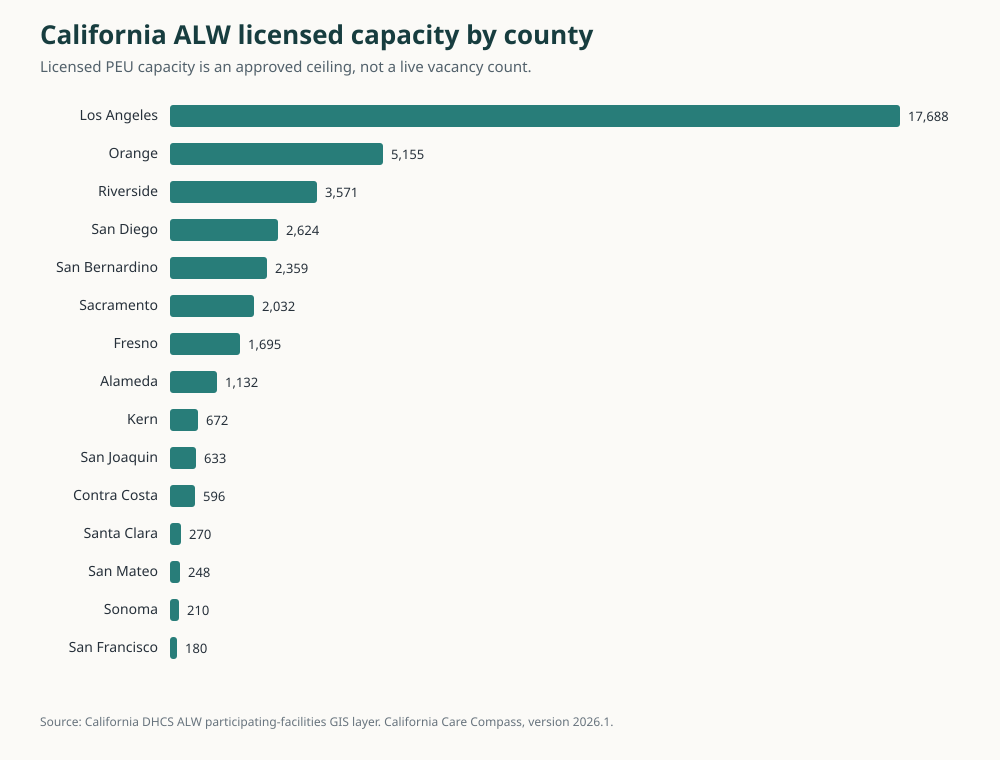

# California Assisted Living Waiver Open Data

County-level availability data for California's Assisted Living Waiver (ALW), a Medi-Cal Home and Community-Based Services program. The dataset covers participating facilities and licensed participant-enrollment-unit capacity in all 15 participating counties, together with statewide enrollment and waitlist totals published by the California Department of Health Care Services (DHCS).

## Headline figures

- 14,847 people enrolled statewide as of December 2025
- 18,365 people on the statewide waitlist as of December 2025
- 15 of California's 58 counties have participating ALW facilities
- DHCS reports one statewide waitlist. This dataset does not invent county-level waitlist estimates.

## Files

- `california-alw-county-tracker-2026.csv`: analysis-ready county table
- `california-alw-county-tracker-2026.json`: metadata, provenance, definitions, and records
- `california-alw-facilities-2026.csv`: 1,224 participating-facility records with names, licensed capacity, location, and public contact fields
- `scripts/fetch_dhcs_alw_facilities.py`: reproducible standard-library script that fetches and normalizes the DHCS ArcGIS layer

## Sources and methodology

The facility counts and licensed capacity fields are derived from the [DHCS ALW participating-facilities GIS dataset](https://gis.dhcs.ca.gov/datasets/CADHCS::alw-assisted-living-facilities/about). Statewide enrollment and waitlist totals come from the [DHCS Assisted Living Waiver enrollment and waitlist report](https://www.dhcs.ca.gov/services/ltc/Documents/ALW-Enrollment-and-Waitlist.pdf).

The facility CSV uses the GIS-derived `CountyName` field. Eleven source records contain a conflict between the free-text `County` field and the mapped `CountyName`; using the mapped field reproduces the published 15-county aggregate exactly. Licensed capacity is a facility's approved participant-enrollment-unit ceiling, not a live vacancy count.

For the human-readable tracker, caveats, downloads, and county breakdowns, see the [California ALW Waitlist and County Availability Tracker](https://californiacarecompass.com/data/california-alw-county-tracker-2026) published by [California Care Compass](https://californiacarecompass.com/).

## License and citation

Released under [CC BY 4.0](https://creativecommons.org/licenses/by/4.0/). You may copy, redistribute, and adapt the data with attribution.

Suggested citation:

> California Care Compass. *California ALW County Availability Tracker 2026*, version 2026.1. Published May 30, 2026. https://californiacarecompass.com/data/california-alw-county-tracker-2026

California Care Compass is a senior-care information and referral service. Participating facilities may pay a referral fee when a family moves forward; that business model is disclosed publicly. The dataset is free, requires no signup, and is licensed for reuse.
