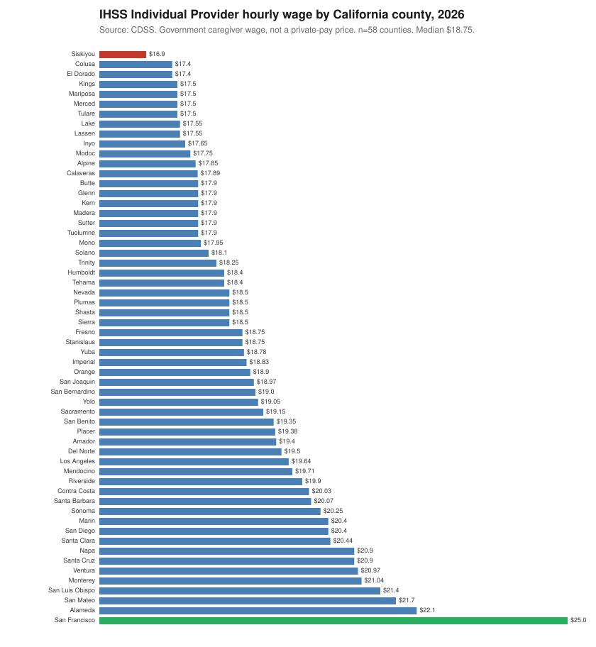

# California Senior Care Rates — Open Data

Reproducible, public-source rate and wage schedules for California senior care.
Every figure in this repository is fetched live from a named government source by
a committed, standard-library-only script. No number is typed by hand, estimated,
or benchmarked to a proprietary survey.

**Version 2026.2 — data retrieved 2026-11-11** (CDSS worksheet `IP Effective 10-1-2026`). Changes since 2026.1: San Francisco $23.00 → $25.00, Del Norte $18.50 → $19.50, Placer $18.50 → $19.38, Amador $18.40 → $19.40 (Siskiyou effective date updated, wage unchanged).



## What this dataset IS

- **IHSS Individual Provider county wage rates (2026):** the hourly wage each of
  California's 58 counties pays an In-Home Supportive Services (IHSS) Individual
  Provider — a Medi-Cal-funded in-home caregiver — as approved by the California
  Department of Social Services (CDSS).

## What this dataset is NOT

This is the critical part. Read it before reusing any number.

- These are **government program wages**, not private-pay prices.
- They are **NOT** private-pay home-care agency retail rates. A private agency
  bills a family more than the IHSS wage (agency overhead, taxes, margin).
- They are **NOT** assisted-living or memory-care monthly prices.
- They are **NOT** survey medians, facility quotes, or observed percentiles.
- The `monthly_fte_illustration_usd` column is an **arithmetic illustration only**
  (`hourly_wage x 173.33`). No family is billed that amount. It exists solely to
  make an hourly figure intuitive.

A reproducible, provider-level, private-pay monthly-price file for California
assisted living or memory care **does not exist in public data.** That data lives
only in proprietary surveys (for example the CareScout / Genworth Cost of Care
Survey, which is still active as of 2026 and should be cited directly, not
reproduced here) and in private aggregators. This repository deliberately does not
invent it.

## Headline figures (2026)

- 58 of 58 California counties covered.
- Lowest IHSS Individual Provider wage: **Siskiyou, $16.90/hour.**
- Highest IHSS Individual Provider wage: **San Francisco, $25.00/hour.**
- Median county wage: **$18.75/hour.** County-to-county spread: **$8.10/hour.**
- All wages carry a `wage_effective_date`; most took effect during 2026.

(The headline numbers above are reproduced by running the script below; they are
not hand-maintained copy.)

## Files

- `california-ihss-county-wages-2026.csv` — analysis-ready county table with
  per-record provenance.
- `california-ihss-county-wages-2026.json` — metadata, provenance, definitions,
  summary, and records.
- `scripts/fetch_ihss_county_wages.py` — reproducible standard-library script that
  downloads the CDSS workbook and normalizes the current IP wage tab.
- `examples/ihss-county-wage-spread.svg` — county wage spread chart.

## Reproduce it yourself

No third-party packages. Python 3 standard library only.

```sh
python3 scripts/fetch_ihss_county_wages.py
```

The script downloads `ip-cc-wages-by-county.xlsx` from CDSS, parses the
`IP Effective 10-1-2026` worksheet directly from the XLSX ZIP/XML (via `zipfile` +
`xml.etree`), and writes the CSV and JSON. Use `--dry-run` to fetch and print
without writing files.

## Sources and methodology

- **Page:** [CDSS IHSS county wage rates](https://www.cdss.ca.gov/inforesources/ihss/county-ihss-wage-rates)
- **File:** `https://www.cdss.ca.gov/Portals/9/IHSS/ip-cc-wages-by-county.xlsx`
- **Worksheet used:** `IP Effective 10-1-2026`
- **License of source:** public domain (California state government).

All provider wages are set by individual counties (typically negotiated with local
SEIU locals) and approved by CDSS. CDSS updates the workbook periodically, so the
`retrieved_at` stamp and `wage_effective_date` per row matter — re-run the script
to refresh.

### Roadmap (not yet included, and why)

- **Medi-Cal Assisted Living Waiver (ALW) reimbursement tiers** — a genuinely
  reproducible DHCS rate schedule, but the DHCS PDF is currently served behind a
  WAF that blocks automated fetches. It will be added once a stable,
  programmatically fetchable source is confirmed. It will **not** be transcribed
  by hand from search snippets.
- **CMS Skilled Nursing Facility cost reports (HCRIS)** — public and downloadable,
  but they are Medicare cost-report accounting, not consumer prices; only a
  clearly-labeled, defensible metric would be added, if any.

## License

Data and code released under **CC BY 4.0**. Attribution:

> California Care Compass. *California Senior Care Rates — Open Data.* Version 2026.2
> (retrieved 2026-11-11). https://github.com/asafichaki/california-senior-care-rates-open-data

Published by [California Care Compass](https://californiacarecompass.com/).
